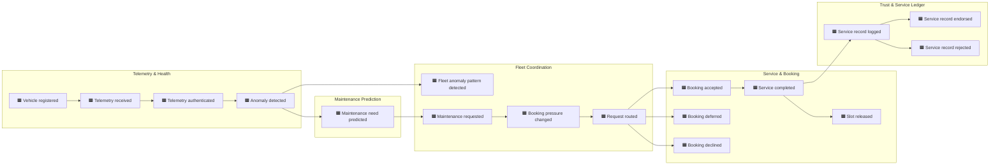

# 1. Knowledge crunching

Knowledge crunching is how the team and the domain experts build a shared model of the domain.
We used **Event Storming**: put every domain event on a timeline, then add what causes each one
(commands, actors, policies) and mark what nobody can explain (hot spots).

## 1.1 Session

| | |
| --- | --- |
| Participants | Mary Anne Selirio (service centre), Dias Katrenov (fleet coordination), Danial Khayatian (vehicle, telemetry, ML) |
| Domain knowledge | each member owned one agent in the integrated project and plays its "domain expert" |
| Format | Big-picture Event Storming, then process-level for the booking flow |
| Date | ❓ fill in |
| Board | ❓ add a photo or export to `docs/ddd/img/event-storming.png` |

Sticky-note legend used below:

| Colour | Meaning |
| --- | --- |
| 🟧 orange | Domain event: something that happened, past tense |
| 🟦 blue | Command: a request to do something |
| 🟨 yellow | Actor: who issues the command |
| 🟪 purple | Policy: "whenever X happens, do Y" |
| 🟩 green | Read model: information someone looks at to decide |
| 🟥 red | Hot spot: question, conflict or unknown |

## 1.2 Big picture: domain events on a timeline

The events below come from the agents' behaviour and the message protocol.

## 1.3 Process level: the booking flow

Commands, actors and policies for the core flow, from a flagged vehicle to an endorsed record.

| Step | Actor 🟨 | Command 🟦 | Read model 🟩 | Event 🟧 | Policy 🟪 that reacts |
| --- | --- | --- | --- | --- | --- |
| 1 | Vehicle | Report telemetry | | Telemetry received | *Authenticate every telemetry record (ECDSA signature)* |
| 2 | Telemetry service | Assess health | thresholds, adaptive sampling rate | Anomaly detected | *When urgency is high, ask Prediction* |
| 3 | Prediction service | Predict maintenance need | telemetry history, model | Maintenance need predicted | *When a need is predicted, the vehicle requests maintenance* |
| 4 | Fleet coordinator | Count anomalies per type | anomaly counts, threshold (2) | Fleet anomaly pattern detected | *Broadcast a collective alert; log it on the ledger* |
| 5 | Vehicle | Request maintenance (part, urgency) | current booking pressure | Maintenance requested | *If pressure is critical and I'm not critical, defer myself* |
| 6 | Fleet coordinator | Route request to a service centre | booking pressure, centre capacity | Booking pressure changed; Request routed | *Every routed request escalates pressure one level* |
| 7 | Service centre | Evaluate booking request | slot calendar, parts stock, technicians, capacity | Booking accepted / deferred / declined | *Accept only if slot + part + capacity + qualified technician* |
| 8 | Service centre | Perform service | | Service completed | *Release the slot after the job; re-advertise capacity* |
| 9 | Service centre | Log service record | | Service record logged | *Ask another organisation to endorse it* |
| 10 | Fleet coordinator | Endorse record | record details | Service record endorsed / rejected | *Each confirmed booking decays pressure one level* |
| — | Clock | Tick (every 2 s) | evaporation counter | Booking pressure changed | *Every 4th tick (about 8 s), evaporate booking pressure one level toward low* |

## 1.4 Hot spots 🟥

Things the current system does that the team could not justify, or that the domain is unclear on.
Each needs a decision before or during the tactical design.

| # | Hot spot | Why it matters | Proposed resolution |
| --- | --- | --- | --- |
| H1 | The service record is created when the booking is **accepted**, not when the service is **completed**. | A record is supposed to prove work was done. Logging it at booking time records work that may never happen. | Log the record on *Service completed*. ❓ confirm |
| H2 | `booking_confirmed` means two different things: a 2-argument message to the vehicle and a 1-argument message to the coordinator. | Same word, two meanings: a language problem, not just a technical one. | Rename: *Booking accepted* (to the vehicle) and *Capacity consumed* (to the coordinator). |
| H3 | A **deferred** booking is treated by the vehicle as confirmed. | The vehicle believes it has a slot it doesn't have. | A deferral is a counter-offer the vehicle must accept or reject. ❓ confirm |
| H4 | Endorsement is always *approve* in the coordinator. | Endorsement with no rule is not a trust mechanism. | Define what an endorser checks: record exists, vehicle registered, part and cost plausible. |
| H5 | "Urgency" has two scales: `low/high` in the vehicle, `low/medium/high/critical` in the shared vocabulary. | Two scales for one concept. | Use the 4-level scale everywhere. |
| H6 | Only one service centre exists, so "routing across service centres" is not really modelled. | The proposal requires routing. | Model routing with N centres; choose by pressure and advertised capacity. |
| H7 | Prediction uses Weka (AdaBoost); the proposal says scikit-learn. | Proposal and system disagree. | Update the proposal: the model choice is behind a port and does not change the domain. |
| H8 | Who are the *stakeholders* that read service history (vehicle owner, service centre, fleet operator), and may they see everything? | Requirement 4 names three readers. | ❓ decide access rules per reader |
| H9 | Booking pressure never evaporated in a running system: the environment added the `tick` percept every 2 s but never removed it, so the coordinator's `+tick` plan fired only once. Pressure stayed `CRITICAL`, every vehicle self-deferred and bookings stopped after a few minutes. | Found while checking the service records in PostgreSQL. | **Resolved**: the environment now adds `tick`, waits 1 s and removes it, so `+tick` fires every 2 s. |

## 1.5 Outcomes

1. A first event list and timeline (above), which seeded the [ubiquitous language](02-ubiquitous-language.md).
2. Five areas that change for different reasons and are owned by different experts: these became
   the [bounded contexts](04-bounded-contexts.md).
3. Nine hot spots (H1–H9), resolved or carried forward as ❓ in the later documents.
