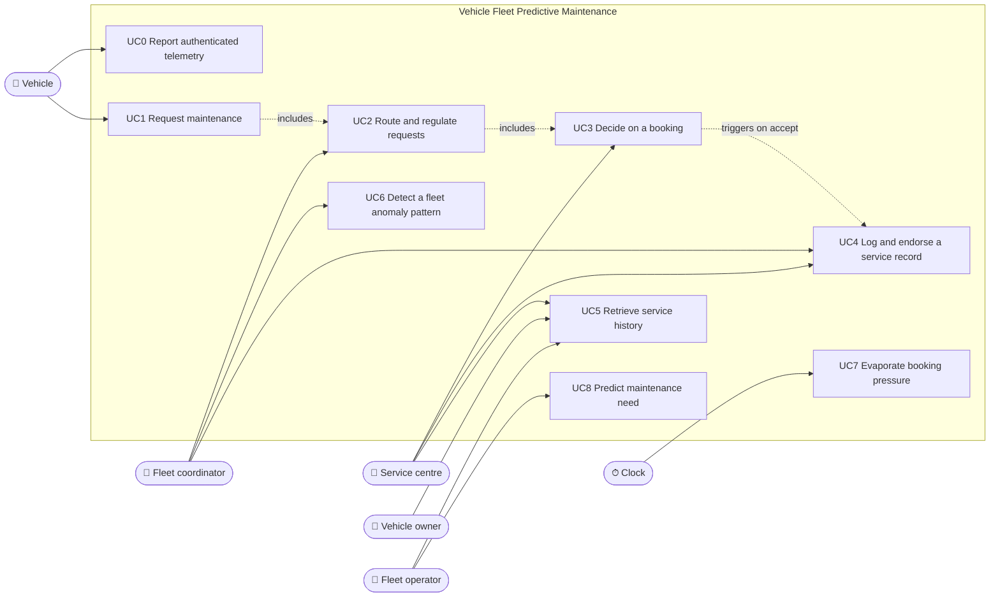

# 3. Use cases

Requirements analysis is driven by use cases: one per coarse requirement in the project
proposal, plus the supporting ones they depend on.

## 3.1 Actors

| Actor | Kind | Goal |
| --- | --- | --- |
| **Vehicle** | system (autonomous agent) | Stay healthy; get serviced when needed without overloading the fleet |
| **Fleet coordinator** | system (autonomous agent) | Keep the fleet healthy and the service centres from overloading |
| **Service centre** | system (autonomous agent) | Use its capacity well; never accept work it can't complete |
| **Vehicle owner** | human stakeholder | Know the service history of their vehicle |
| **Fleet operator** | human stakeholder | Oversee the fleet's maintenance and costs |
| **Clock** | time | Drive periodic behaviour (pressure evaporation, sampling) |

## 3.2 Use-case diagram

## 3.3 Traceability

| Proposal requirement | Use case | Bounded context |
| --- | --- | --- |
| R1 A vehicle whose health is flagged shall request maintenance. | UC1 (with UC0) | Fleet Coordination (Telemetry & Health, Prediction) |
| R2 The coordinator shall route and regulate requests across service centres. | UC2, UC7 | Fleet Coordination |
| R3 A service centre shall accept, defer, or decline a request based on capacity, technician qualification, and parts availability, and shall log an endorsed, immutable service record on completion. | UC3, UC4 | Service & Booking, Trust & Service Ledger |
| R4 Stakeholders shall retrieve a vehicle's service history. | UC5 | Trust & Service Ledger |
| (supports R1) Maintenance need is predicted from vehicle data. | UC8 | Maintenance Prediction |
| R5 The system shall be deployable as containerized services and exercised end-to-end through automated pipelines. | (non-functional) | all: see the CircleCI pipeline and `docker-compose.yml` |

## 3.4 Use-case descriptions

### UC0 Report authenticated telemetry
- **Actor:** Vehicle. **Context:** Telemetry & Health.
- **Trigger:** sampling interval elapsed (5 s / 2 s / 1 s by temperature).
- **Main flow:**
  1. The vehicle signs a telemetry record with its private key and sends it.
  2. The system checks the signature against the vehicle's registered public key.
  3. The system updates the vehicle's digital twin and assesses its health.
  4. If a reading is out of range, the system raises *Anomaly detected*.
- **Alternatives:** 2a. Signature invalid or vehicle not registered: the record is discarded and logged.
- **Postcondition:** the digital twin reflects the latest authenticated telemetry.

### UC1 Request maintenance
- **Actor:** Vehicle. **Context:** Fleet Coordination.
- **Precondition:** the vehicle's health is flagged (urgency `HIGH` or above, or a maintenance need predicted).
- **Main flow:**
  1. The vehicle reads the current booking pressure.
  2. The vehicle sends a maintenance request (VIN, part, urgency).
  3. *includes* UC2.
- **Alternatives:**
  - 1a. Pressure is `CRITICAL` and the vehicle's urgency is not `CRITICAL`: the vehicle defers itself and retries on a later cycle (self-deferral).
  - 2a. A fleet anomaly alert for brake wear was received: the requested part becomes `brake_pad`.
- **Postcondition:** a maintenance request exists, or the vehicle has deferred itself.

### UC2 Route and regulate requests
- **Actor:** Fleet coordinator. **Context:** Fleet Coordination.
- **Trigger:** *Maintenance requested*.
- **Main flow:**
  1. The coordinator raises booking pressure one level and broadcasts it.
  2. The coordinator chooses a service centre: the one with the highest advertised free capacity. *(Proposed: today there is only one centre; hot spot H6.)*
  3. The coordinator forwards the request to that centre (*Request routed*); *includes* UC3.
  4. On *Booking accepted*, the coordinator lowers booking pressure one level.
- **Alternatives:** 1a. Pressure is `HIGH` or `CRITICAL` after raising it: the coordinator sends an overload warning with that level to the centres.
- **Business rule:** vehicles never contact a service centre directly.

### UC3 Decide on a booking
- **Actor:** Service centre. **Context:** Service & Booking.
- **Trigger:** a routed booking request (VIN, part, urgency).
- **Main flow (accept):** a free slot, the part in stock, free capacity and a technician qualified for the part all exist, so the centre reserves all four and raises *Booking accepted* (slot, centre).
- **Alternatives**, checked in this order; exactly one outcome per request:
  1. Part out of stock: *Booking declined* (`PARTS_SHORTAGE`).
  2. No technician qualified for the part: *Booking declined* (`NO_QUALIFIED_TECHNICIAN`).
  3. No free capacity: *Booking deferred* (next available).
  4. No free slot: *Booking deferred* (next available).
  5. Anything else: *Booking declined* (`UNAVAILABLE`).
- **Postcondition:** on accept, slot, capacity and one part are reserved; otherwise nothing changes.
- ❓ **Open (H3):** must the vehicle explicitly accept a deferral?

### UC4 Log and endorse a service record
- **Actors:** Service centre (logs), Fleet coordinator (endorses). **Context:** Trust & Service Ledger.
- **Trigger:** *Service completed* (see hot spot H1).
- **Main flow:**
  1. The ledger creates a service record (next record number, VIN, part, technician, cost = part cost + labour).
  2. The ledger asks another organisation to endorse it.
  3. The endorser checks the record and approves it; the record is *committed*.
- **Alternatives:**
  - 3a. The endorser rejects: the record is put on *integrity hold*.
  - 3b. A second endorsement arrives for an already-decided record: refused; a record is decided exactly once.
- **Business rules:** record numbers are strictly increasing; the endorser must differ from the logger; a decided record never changes.
- ✅ **Implemented:** the service centre's `writeServiceRecord(RID, Vehicle, Part, Tech, Cost)` action runs `LogServiceRecord` (stores the record in PostgreSQL and hands it to `BlockchainPort`); the endorsement reply runs `EndorseServiceRecord` through the `endorseServiceRecord` action. Rule 3b is enforced twice: by `ServiceRecord.endorse()` and by a database trigger. Today the record is logged when the booking is **accepted**, not on *Service completed* (hot spot H1 still open).

### UC5 Retrieve service history
- **Actors:** Vehicle owner, Fleet operator, Service centre. **Context:** Trust & Service Ledger.
- **Main flow:** the stakeholder asks for a VIN's history; the system returns all **committed** records for that VIN, oldest first.
- **Alternatives:** unknown VIN: an empty history, not an error.
- ❓ **Open (H8):** may a vehicle owner see costs? May a service centre see other centres' records?
- ✅ **Partly implemented:** the dashboard lists all stored service records, newest first, with their endorsement status (`GET /api/service-records`). 🎯 Still missing: the per-VIN view, committed records only, and access rules.

### UC6 Detect a fleet anomaly pattern
- **Actor:** Fleet coordinator. **Context:** Fleet Coordination.
- **Trigger:** *Anomaly detected* for any vehicle.
- **Main flow:** the coordinator counts anomalies per type. When a type reaches the threshold (2 vehicles), it broadcasts a *Fleet anomaly pattern detected* alert and logs it on the ledger.

### UC7 Evaporate booking pressure
- **Actor:** Clock. **Context:** Fleet Coordination.
- **Main flow:** the clock ticks every 2 s; every 4th tick (about 8 s), booking pressure decays one level toward `LOW` and the new level is broadcast.
- ✅ **Implemented** in the coordinator's `+tick` plans (`evaporation_rate(3)`); the environment raises a new `tick` every 2 s (hot spot H9).

### UC8 Predict maintenance need
- **Actor:** Fleet operator (reads the result); the prediction service runs on start-up. **Context:** Maintenance Prediction.
- **Main flow:**
  1. The prediction service takes each vehicle instance from the template (9 today).
  2. The Weka model returns a class (`0` / `1`) and a confidence.
  3. A `1` below 70 % confidence is turned into *no maintenance needed*.
  4. The prediction is stored (`maintenance_prediction`) and listed on the dashboard, newest first.
- **Alternatives:** no database configured: the prediction is only written to the log file.
- ✅ **Implemented:** `ML-model/main.py` (`save_to_database`), `GET /api/ml-predictions`, the dashboard's "ML Predictions" card.
- 🎯 **Not yet:** the agents do not read these predictions; `MLPredictionPort` is still served by `MockMLPipeline`, so UC1 does not depend on UC8 yet.
