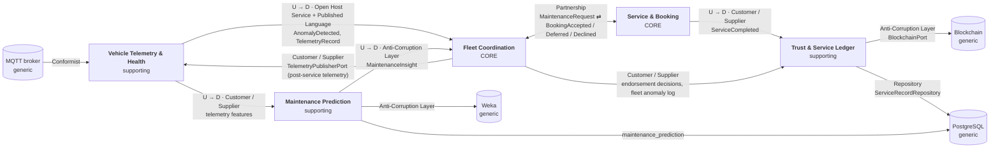

# 4. Bounded contexts and context map

## 4.1 Bounded contexts

Each context has one model, one owner and its own meaning for shared words
(see [Ubiquitous language §2.3](02-ubiquitous-language.md#23-same-word-different-meaning)).
The split follows where the domain changes for different reasons: booking rules change when
workshops change; telemetry rules change when sensors change.

| Context | Subdomain | Responsibility | Key concepts | Owner | Runs in |
| --- | --- | --- | --- | --- | --- |
| **Service & Booking** | **Core** | Decide on booking requests with finite capacity, technicians, parts and slots; perform the service | ServiceCenter, Booking, Slot, Technician, PartsInventory | Mary Anne | Multi-Agent-System (ServiceCenterAgent) |
| **Fleet Coordination** | **Core** | Regulate demand across the fleet with booking pressure, route requests, detect fleet-wide anomaly patterns | FleetCoordinator, MaintenanceRequest, BookingPressure | Dias | Multi-Agent-System (FleetCoordinatorAgent) |
| **Vehicle Telemetry & Health** | Supporting | Collect and authenticate telemetry, keep the digital twin, assess health and urgency | VehicleTwin, TelemetryRecord, Anomaly, HealthAssessment | Danial | Embedded-Systems-gs-main (IoT control unit), VehicleAgent |
| **Maintenance Prediction** | Supporting | Predict maintenance need from telemetry and history | MaintenancePrediction, confidence | Danial | ML-model; PostgreSQL table `maintenance_prediction` |
| **Trust & Service Ledger** | Supporting | Keep immutable, endorsed service records; serve service history | ServiceRecord, Endorsement, ServiceHistory | Dias + Mary Anne | Multi-Agent-System (`ServiceRecordRepository` → PostgreSQL table `service_record`), dashboard backend |

**Generic subdomains** (bought or borrowed, not modelled by us): ECDSA cryptography, MQTT messaging
(Mosquitto), the blockchain platform, the ML library (Weka), the BDI runtime (Jason), and storage
(PostgreSQL 16).

**Why these two are core:** they hold the decisions that make this system different from any
fleet tracker: *self-regulating demand without a central scheduler* (Fleet Coordination) and
*never accepting work that cannot be completed* (Service & Booking). The supporting contexts are
necessary but could be replaced by standard solutions.

## 4.2 Context map

Arrows point from **upstream** (U, the supplier of a model or events) to **downstream** (D, the
consumer). Labels give the relationship pattern and what crosses the boundary.



### Relationships

| Upstream → Downstream | Pattern | What crosses | Why this pattern |
| --- | --- | --- | --- |
| Telemetry & Health → Fleet Coordination | **Open Host Service + Published Language** | `AnomalyDetected(vin, type, severity)`; telemetry packets on MQTT topic `vehicle/telemetry` (`VIN:…\|TEMP:…\|MILEAGE:…\|STATE:…\|TIMESTAMP:…\|SIG:…`) | Several consumers read the same stream; a documented format serves all of them. |
| Telemetry & Health → Maintenance Prediction | **Customer / Supplier** | telemetry features (temperature, mileage, component conditions, reported issues) | Prediction needs specific features; the telemetry team agrees to supply them. |
| Maintenance Prediction → Fleet Coordination | **Anti-Corruption Layer** | `MaintenanceInsight` via `MLPredictionPort` | The model's raw output (Weka class labels, confidences) must not leak into the core. The ACL already exists in code: `application/port/MLPredictionPort.java`, `MaintenanceInsight.java`. |
| Fleet Coordination ⇄ Service & Booking | **Partnership** | `MaintenanceRequest` → `BookingRequested`; back: `BookingAccepted`, `BookingDeferred`, `BookingDeclined`, `ServiceCenterCapacityAdvertised` | Both are core, and they succeed or fail together. The message protocol is co-owned and changed jointly (see `message_protocol.md`). |
| Service & Booking → Trust & Service Ledger | **Customer / Supplier** | `ServiceCompleted(bookingId, vin, part, technician, cost)` | The ledger serves the service centre's need to prove its work. |
| Fleet Coordination → Trust & Service Ledger | **Customer / Supplier** | endorsement decisions; `FleetAnomalyPatternDetected` log entries | The coordinator acts as a second organisation that co-signs records. |
| Trust & Service Ledger → Blockchain | **Anti-Corruption Layer** | `BlockchainPort` (`MockBlockchainClient`, `RealBlockchainClient`) | The domain talks about service records; the ACL turns them into chain transactions. Mock and real implementations are interchangeable. |
| MQTT broker → Telemetry & Health | **Conformist** | MQTT topics and payloads | We adopt the broker's model as-is. |
| Fleet Coordination → Telemetry & Health | **Customer / Supplier** | JSON `{vin, temp, mileage, state}` over `POST /api/publish-telemetry`, published by the IoT unit on `vehicle/telemetry` | After a service the coordinator pushes the vehicle's new state back to the edge. ✅ In code: `TelemetryPublisherPort` with the `IoTControlUnitClient` adapter; contract tested on both sides (JUnit and the Node MQTT tests). |
| Trust & Service Ledger → PostgreSQL | **Repository** (behind a port) | whole `ServiceRecord` aggregates | ✅ `PostgresServiceRecordRepository` implements `ServiceRecordRepository`; the domain does not know SQL. A trigger also refuses to change a decided record. |
| Maintenance Prediction → PostgreSQL | stores its own table | one row per prediction in `maintenance_prediction` | ✅ Written by `ML-model/main.py`. Each context owns its own table; the dashboard only reads them. |

## 4.3 Integration events

Events that cross a context boundary. Inside a context, events can change freely; these cannot
without agreement from the downstream owner.

| Event | Published by | Consumed by | Payload |
| --- | --- | --- | --- |
| `AnomalyDetected` | Telemetry & Health | Fleet Coordination | vin, anomalyType, severity, timestamp |
| `MaintenancePredicted` | Maintenance Prediction | Fleet Coordination (via ACL) | vin, needed (bool), confidence, part |
| `MaintenanceRequested` | Fleet Coordination (on behalf of a vehicle) | Fleet Coordination | vin, part, urgency |
| `BookingRequested` | Fleet Coordination | Service & Booking | requestId, vin, part, urgency |
| `BookingAccepted` | Service & Booking | Fleet Coordination, Vehicle | bookingId, vin, slot, centreId |
| `BookingDeferred` | Service & Booking | Fleet Coordination, Vehicle | requestId, vin, alternativeSlot, centreId |
| `BookingDeclined` | Service & Booking | Fleet Coordination, Vehicle | requestId, vin, reason |
| `ServiceCenterCapacityAdvertised` | Service & Booking | Fleet Coordination | centreId, freeCapacity |
| `BookingPressureChanged` | Fleet Coordination | Vehicles | level |
| `FleetAnomalyPatternDetected` | Fleet Coordination | Vehicles, Trust & Service Ledger | anomalyType, vehicleCount |
| `ServiceCompleted` | Service & Booking | Trust & Service Ledger | bookingId, vin, part, technician, cost |
| `ServiceRecordEndorsed` | Trust & Service Ledger | Service & Booking, Fleet Coordination | recordId, vin, approved |

Mapping to the agents' current messages (`message_protocol.md`):

| Current message | Becomes |
| --- | --- |
| `book_request/3` | `MaintenanceRequested` |
| `booking_request/3` | `BookingRequested` |
| `booking_confirmed/2` (to vehicle) | `BookingAccepted` |
| `booking_confirmed/1` (to coordinator) | `BookingAccepted` (same event, both subscribers; removes hot spot H2) |
| `booking_deferred/2`, `booking_declined/1` | `BookingDeferred`, `BookingDeclined` |
| `booking_pressure/1` | `BookingPressureChanged` |
| `fleet_anomaly_alert/2` | `FleetAnomalyPatternDetected` |
| `service_center_capacity/1` | `ServiceCenterCapacityAdvertised` |
| `service_completed/2` | `ServiceCompleted` |
| `endorse_request/2`, `endorsement/2` | endorsement command and `ServiceRecordEndorsed` |

## 4.4 From today's code to one package per context

🎯 **Target, not yet done.** Today, `Multi-Agent-System` has a single layered structure shared by everything. The target gives
each context its own Clean Architecture layers, so dependencies only point inwards
(infrastructure → application → domain) and contexts talk only through the events above.

| Today | Target |
| --- | --- |
| `domain/model/ServiceRecord.java`, `Endorsement.java` | `ledger/domain/` |
| `domain/event/ServiceRecordEndorsed.java` | `ledger/domain/event/` |
| `application/usecase/EndorseServiceRecord.java` | `ledger/application/` |
| `application/port/BlockchainPort.java`, `ServiceRecordRepository.java` | `ledger/application/port/` |
| `application/usecase/LogServiceRecord.java` | `ledger/application/` |
| `infrastructure/MockBlockchainClient.java`, `RealBlockchainClient.java`, `InMemoryServiceRecordRepository.java`, `PostgresServiceRecordRepository.java` | `ledger/infrastructure/` |
| `application/port/TelemetryPublisherPort.java` | `fleetcoordination/application/port/` (toward Telemetry & Health) |
| `infrastructure/IoTControlUnitClient.java` | `fleetcoordination/infrastructure/` |
| `domain/model/BookingPressure.java` | `fleetcoordination/domain/` |
| `domain/event/FleetAnomalyDetected.java` | `fleetcoordination/domain/event/FleetAnomalyPatternDetected.java` |
| `application/usecase/LogFleetAnomaly.java` | `fleetcoordination/application/` |
| `application/port/MLPredictionPort.java`, `MaintenanceInsight.java` | `fleetcoordination/application/port/` (the ACL toward Prediction) |
| `infrastructure/MockMLPipeline.java` | `fleetcoordination/infrastructure/` |
| `application/usecase/RegisterVehicle.java` | `telemetry/application/` |
| *(missing)* | `servicebooking/{domain,application,infrastructure}`: see the [tactical model](05-tactical-model.md) |
| `env/FleetMASEnvironment.java` | stays in `env/`: the adapter between Jason agents and the application layer of each context |

```
Multi-Agent-System/
├── servicebooking/        CORE
│   ├── domain/            ServiceCenter, Booking, Slot, Technician, PartId, Capacity, events
│   ├── application/       DecideOnBooking, CompleteService, ports
│   └── infrastructure/    InMemoryServiceCenterRepository
├── fleetcoordination/     CORE
│   ├── domain/            FleetCoordinator, MaintenanceRequest, BookingPressure, events
│   ├── application/       RouteMaintenanceRequest, DetectFleetAnomalyPattern, ports (ML ACL)
│   └── infrastructure/    MockMLPipeline, InMemoryFleetRepository
├── ledger/                SUPPORTING
│   ├── domain/            ServiceRecord, Endorsement, events
│   ├── application/       LogServiceRecord, EndorseServiceRecord, ports (BlockchainPort)
│   └── infrastructure/    Mock/RealBlockchainClient, InMemoryServiceRecordRepository
├── telemetry/             SUPPORTING (Java side; the IoT unit is in Embedded-Systems-gs-main)
│   └── application/       RegisterVehicle
├── shared/                Vin, Urgency, DomainEvent (shared kernel, kept minimal)
└── env/                   Jason ↔ application adapter
```

**Shared kernel:** only `Vin`, `Urgency` and the `DomainEvent` interface are shared, and every
team owns them jointly. Anything else that looks shared is translated at the boundary.

An **ArchUnit** test will enforce the rules in CI: no `domain` package imports `application` or
`infrastructure`, and no context imports another context's `domain`.
