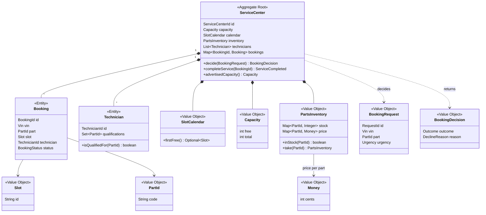
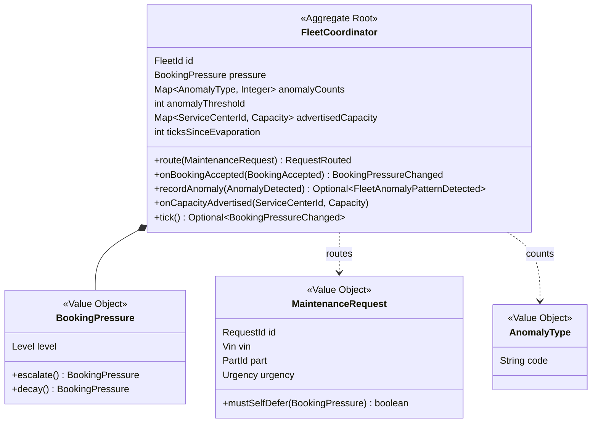

# 5. Tactical model

Tactical patterns for the two core contexts, plus the two supporting contexts that are already in
code (the ledger and the prediction store). ✅ = on `main`, 🎯 = target design.
Every rule here is an **invariant**: something the aggregate guarantees is always true and the
tests check.

## 5.1 Service & Booking (core) — 🎯 target design

None of the classes in this section exist yet: on `main` the service centre agent still takes these
decisions in AgentSpeak (`service_center_agent.asl`). The model below is what the agent's rules
become once they move into Java.

### Aggregate: `ServiceCenter`

The service centre is the consistency boundary: capacity, slots, parts stock and technicians must
change together, or a booking could take a slot without a technician. So they live in one
aggregate, and only `ServiceCenter` methods change them.

| Element | Pattern | Notes |
| --- | --- | --- |
| `ServiceCenter` | Aggregate root | The only entry point; identity `ServiceCenterId` |
| `Booking` | Entity | Identity `BookingId`; lifecycle `ACCEPTED → COMPLETED` |
| `Technician` | Entity | Identity `TechnicianId`; qualifications can change over time |
| `Slot`, `SlotCalendar`, `Capacity`, `PartsInventory`, `PartId`, `Money`, `BookingRequest`, `BookingDecision` | Value objects | Immutable; `take()` and `reserve()` return new values |
| `DeclineReason` | Enum | `PARTS_SHORTAGE`, `NO_QUALIFIED_TECHNICIAN`, `UNAVAILABLE` |
| `BookingAccepted`, `BookingDeferred`, `BookingDeclined`, `ServiceCompleted` | Domain events | Returned by `decide()` and `completeService()` |
| `ServiceCenterRepository` | Repository (port) | `findById`, `save`; in-memory implementation for tests |
| `DecideOnBooking`, `CompleteService` | Application services (use cases) | Load the aggregate, call it, save it, publish the events |

**Invariants**

1. `decide()` returns exactly one outcome per request, checked in this order: part out of stock → *declined* (`PARTS_SHORTAGE`); no qualified technician → *declined* (`NO_QUALIFIED_TECHNICIAN`); no free capacity → *deferred*; no free slot → *deferred*; otherwise → *accepted*.
2. Accepting a booking reserves **one slot, one unit of capacity, one part and one qualified technician**, all together or none.
3. Free capacity is never negative and never exceeds total capacity.
4. Parts stock is never negative.
5. A slot is held by at most one booking.
6. `completeService()` only works on an `ACCEPTED` booking; it releases the slot and the capacity (not the part, which was used). Completing twice is refused.
7. The cost of a service = part cost + one labour hour.

### Domain service: none needed
All rules depend only on state inside one `ServiceCenter`, so they stay in the aggregate.

## 5.2 Fleet Coordination (core) — 🎯 target design, except `BookingPressure`

Only `BookingPressure`, `FleetAnomalyDetected` and the `MLPredictionPort` ACL exist today; the
coordinator agent applies the other rules in AgentSpeak (`fleet_coordinator_agent.asl`).

### Aggregate: `FleetCoordinator`

Booking pressure, anomaly counts and the centres' advertised capacities are read and changed by
the same decisions, so they form one aggregate.

| Element | Pattern | Notes |
| --- | --- | --- |
| `FleetCoordinator` | Aggregate root | One per fleet |
| `BookingPressure` | Value object | **Exists** (`domain/model/BookingPressure.java`); saturates at `LOW` and `CRITICAL` |
| `MaintenanceRequest`, `AnomalyType`, `RequestId` | Value objects | |
| `MaintenanceRequested`, `RequestRouted`, `BookingPressureChanged`, `FleetAnomalyPatternDetected` | Domain events | `FleetAnomalyPatternDetected` replaces today's `FleetAnomalyDetected` |
| `FleetRepository` | Repository (port) | |
| `MLPredictionPort` → `MaintenanceInsight` | Port + ACL | **Exists**; isolates the Weka output |
| `RouteMaintenanceRequest`, `DetectFleetAnomalyPattern`, `EvaporatePressure` | Application services | |

**Invariants**

1. Each routed request escalates pressure exactly one level; each accepted booking decays it exactly one level; pressure never goes beyond `LOW` or `CRITICAL`.
2. Every 4th tick (about 8 s) decays pressure one level (hot spot H9 fixed the tick so this happens at runtime).
3. A request goes to the centre with the highest advertised free capacity; ties go to the centre that has gone longest without a request. No centre with zero advertised capacity is chosen while another has some.
4. A `FleetAnomalyPatternDetected` event is raised once per anomaly type, when its count first reaches the threshold (default 2).
5. Self-deferral: `MaintenanceRequest.mustSelfDefer(pressure)` is true when pressure is `CRITICAL` and the request's urgency is not `CRITICAL`. *(A policy that runs on the vehicle side, but its rule lives in this context's language.)*

## 5.3 Trust & Service Ledger (supporting) — ✅ in code

| Element | Pattern | Status |
| --- | --- | --- |
| `ServiceRecord` | Aggregate root | ✅ Invariant enforced: a record is decided exactly once. `ServiceRecord.restore(...)` rebuilds a stored record with its endorsement. |
| `Endorsement` | Value object | ✅ |
| `ServiceRecordEndorsed` | Domain event | ✅ |
| `ServiceRecordRepository` | Repository (port) | ✅ Two adapters: `InMemoryServiceRecordRepository` (tests, no `DATABASE_URL`) and `PostgresServiceRecordRepository` (table `service_record`). |
| `BlockchainPort` | Port + ACL | ✅ Mock and real implementations; `writeServiceRecord` is still a stub. |
| `LogServiceRecord` | Application service | ✅ Called by the agents' `writeServiceRecord(RID, Vehicle, Part, Tech, Cost)` action: builds the aggregate, refuses a duplicate id, stores it, hands it to `BlockchainPort`. 🎯 Should react to `ServiceCompleted` instead of the accepted booking (hot spot H1). |
| `EndorseServiceRecord` | Application service | ✅ Called by the agents' `endorseServiceRecord(RID, Endorser, approve\|reject)` action. |
| `ServiceHistory` | Read model | ✅ Partly: the dashboard lists all records newest first (`GET /api/service-records`). 🎯 Per VIN, committed only, oldest first (UC5). |

**The endorse-once invariant is enforced twice:** in the aggregate (`endorse()` throws on a second
decision) and in PostgreSQL (trigger `service_record_decided_once` refuses to update a decided row),
so even a bug in another adapter cannot change a committed record.

Invariants to add: record numbers strictly increase across restarts (today the agent restarts its
counter at 1, so a restart on old data refuses the first booking as a duplicate); the endorser
differs from the organisation that logged the record (hot spot H4).

## 5.3b Maintenance Prediction (supporting) — ✅ store in code

| Element | Pattern | Status |
| --- | --- | --- |
| Prediction (one row of `maintenance_prediction`) | Value object, stored as written | ✅ `ML-model/main.py`: `save_to_database(...)` after each Weka prediction; never updated afterwards. |
| 70 % confidence filter | Domain rule | ✅ A Weka `1` below 70 % confidence becomes *no maintenance needed*. |
| `MLPredictionPort` → `MaintenanceInsight` | Port + ACL toward Fleet Coordination | ✅ Exists, but 🎯 still served by `MockMLPipeline`: the agents do not read the stored predictions yet. |

The prediction context owns its table and writes it directly from Python; the agents and the
dashboard never write to it.

## 5.4 Answer to "should the existing classes be split further?"

No. `ServiceRecord` (aggregate root), `Endorsement` and `BookingPressure` (value objects) are
already the right size: each protects one clear rule. What was missing was **placement** (they
belong to two different contexts, see [§4.4](04-bounded-contexts.md#44-from-todays-code-to-one-package-per-context))
and the **two core aggregates** above, which did not exist in Java at all.

## 5.5 Tests

✅ **On `main` today** (all run in CircleCI):

| Test | Checks |
| --- | --- |
| `ServiceRecordTest` | aggregate invariants; endorse once, reject once, invalid fields refused |
| `EndorseServiceRecordTest`, `LogFleetAnomalyTest`, `LogServiceRecordTest` | use cases with hand-written fake ports; duplicate ids refused; a logged record can be endorsed once |
| `PostgresServiceRecordRepositoryTest` | save and load against a real PostgreSQL; the database refuses to change a decided record |
| `IoTControlUnitClientTest` and `test/mqtt.test.js` | the Fleet Coordination → Telemetry & Health contract, from both sides |
| `tests/test_main.py` | the Weka prediction end to end; storing a prediction |

🎯 **Planned** for the target aggregates: one unit test per invariant, named after the rule, for
example `acceptingReservesSlotCapacityPartAndTechnicianTogether()` or
`partShortageIsCheckedBeforeQualification()`, and an ArchUnit test for the dependency rules from
[§4.4](04-bounded-contexts.md#44-from-todays-code-to-one-package-per-context).
